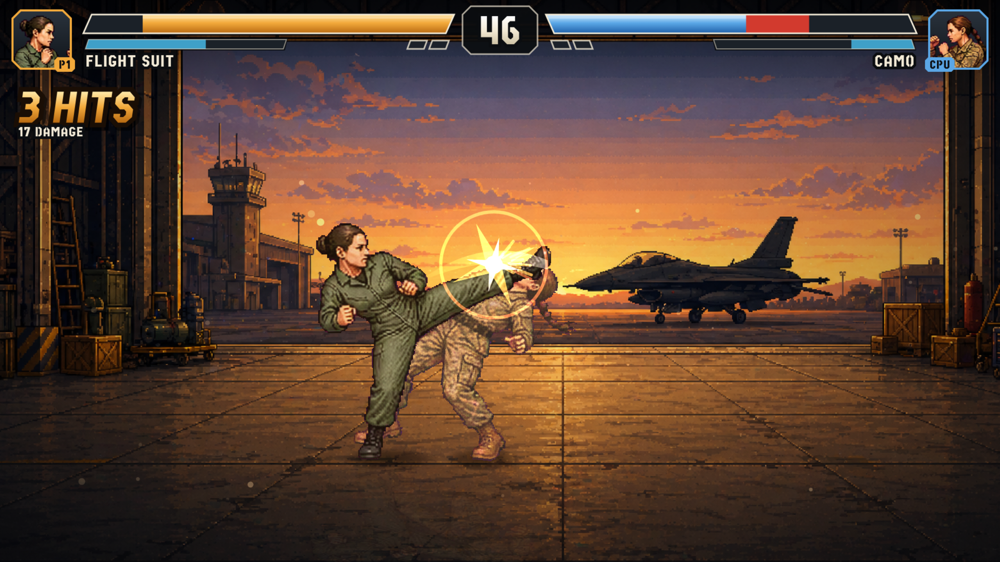
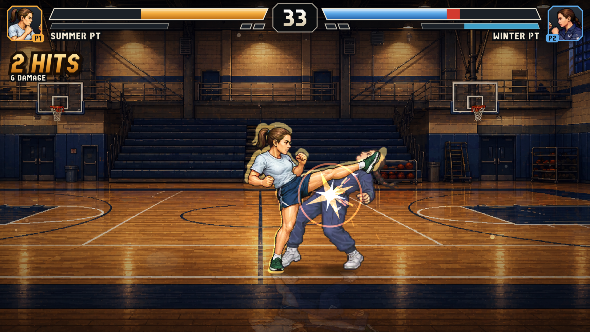
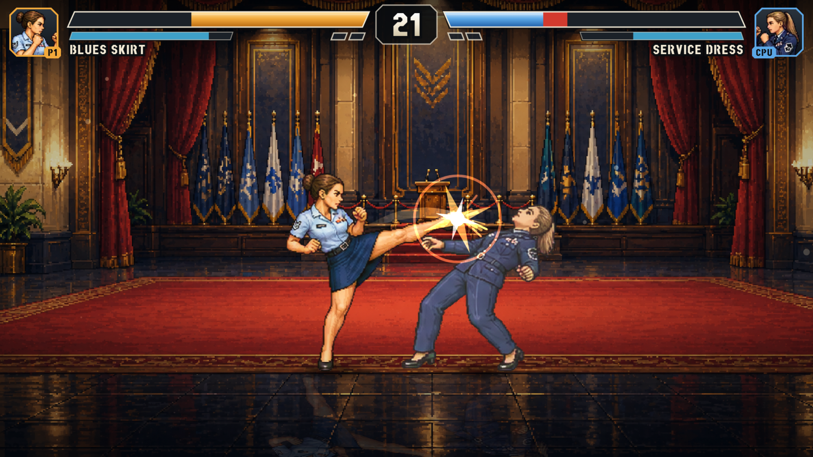

# Hangar Fighter

A browser-based 2D arcade fighting game prototype with scenario-based matchups, desktop keyboard play, and mobile touch controls.

Play it here:

https://vibezzzcoder.github.io/hangar-fighter/

## Status

A published prototype. The 2026-11-10 release is a full polish overhaul: new combat
system, CPU opponent, HUD, menus, sound effects and touch controls, with the music and
announcer line kept. Versus Mode and Boss Rush Mode are both complete, and the automated
checks pass on the self-contained release build served at the link above.

## Screenshots

## Features

- **Versus**: pick any two fighters and any of six stages; play the CPU (Easy / Normal /
  Hard) or a second player on the same keyboard. Best of three rounds.
- **Boss Rush**: take the MTI (or any fighter you have unlocked) through three bosses, each a
  best-of-three. Beating a boss unlocks her as a playable fighter.
- Combos (punch, punch, kick), dashes, guard breaks, counter hits, knockdowns, and a super
  move once your meter is full.
- A CPU that reacts, punishes and spaces instead of pressing random buttons.
- Per-stage music, an announcer line at the start of a match, and a full set of sound
  effects.
- Touch controls for phones in portrait and landscape; keyboard controls on desktop.
- Options (music and effects volume, CPU level, screen shake) that are remembered.
- Runs as one self-contained HTML file with no downloads or accounts.

## How to play

- **Combo**: punch, punch, kick. Each hit chains into the next when it lands.
- **Dash**: double-tap left or right. Dash in, then attack out of it.
- **Block**: hold block to stop hits. A blocked kick can be punished.
- **Guard break**: punch a blocking opponent from point-blank range.
- **Duck**: crouch under high kicks, then hit back while they recover.
- **Jump in**: a jump kick that lands leads straight into a ground combo.
- **Super**: landing and taking hits fills the bar under your health. When it reads SUPER,
  press punch and kick together (or the SUPER button on a phone).
- **Counter**: hit an opponent out of their own attack for extra damage.

## Controls

Player 1:

- `A` / `D` = move (double-tap to dash)
- `W` = jump
- `S` = crouch
- `R` = block
- `F` = punch
- `G` = kick
- `T` = super (or `F` + `G` together)

Player 2:

- `Left` / `Right` = move (double-tap to dash)
- `Up` = jump
- `Down` = crouch
- `O` = block
- `K` = punch
- `L` = kick
- `P` = super (or `K` + `L` together)

System:

- `Esc` or `Space` = pause (resume, how to play, options, restart, change fighters, main menu)
- Menus: arrows or `WASD` to move, left/right to change a value, `Enter` to confirm, `Esc` to go back
- Player 2 is the CPU by default; switch `Opponent` to `Player 2` on the fight setup screen for two players
- `H` = show hit and hurt boxes (a tuning aid)

Phones and tablets:

- Touch controls appear automatically, in portrait and in landscape.
- The direction pad is one surface: roll your thumb across it without lifting.
- The top row of the pad jumps (straight up, or diagonally).
- For the roomiest view use landscape, and `Add to Home Screen` for fullscreen play.

## Local Play

Open `index.html` directly in a desktop browser, or host the repository with any static file server.

No build step is required for local play.

## Attribution

Created by [@VibezZzCoder](https://github.com/VibezZzCoder).

Hangar Fighter is an independent fan/prototype project and is not an official U.S. Air Force product. It is not endorsed by, sponsored by, or affiliated with the U.S. Air Force, the Department of the Air Force, or the U.S. Department of Defense.

The project uses fictionalized, stylized, military-inspired characters and settings. No official endorsement is implied.

## Contributing

Issues, suggestions, and pull requests are welcome. Please keep contributions respectful and consistent with the project's fictional, unofficial nature.

## License

Hangar Fighter is licensed under the GNU General Public License v3.0 or later.

Copyright (C) 2026 VibezZzCoder

This project is free software: you can redistribute it and/or modify it under the terms of the GNU General Public License as published by the Free Software Foundation, either version 3 of the License, or, at your option, any later version.

This project is distributed in the hope that it will be useful, but WITHOUT ANY WARRANTY; without even the implied warranty of MERCHANTABILITY or FITNESS FOR A PARTICULAR PURPOSE. See the GNU General Public License for more details.

The license applies to this project's original code and assets. It does not grant rights to use any third-party trademarks, logos, seals, emblems, or official marks.

The copyright notice applies to this independent fan/prototype project's original code and original assets only. It does not claim ownership of, endorsement by, or affiliation with the U.S. Air Force, the Department of the Air Force, or the U.S. Department of Defense.

See `LICENSE` for the full license text.
